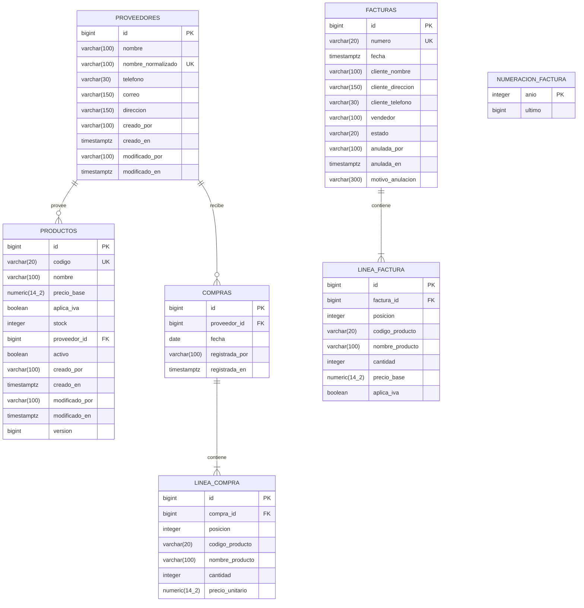

# Modelo de datos

Esquema relacional del `domain-service-ferreteria`. Se genera con Hibernate
(`spring.jpa.hibernate.ddl-auto=update`) tanto en H2 (desarrollo y pruebas, con
`MODE=PostgreSQL`) como en PostgreSQL 16 (perfil `prod`). La sustitución por
migraciones Flyway queda como mejora pendiente.

Convenciones:

- Claves primarias `bigint` con identidad (`GENERATED BY DEFAULT AS IDENTITY`).
- Dinero en `numeric(14,2)`; nunca `float`.
- Fechas de negocio en `date` (día de Bogotá) y marcas de tiempo en
  `timestamp(6) with time zone` (`Instant`).
- Nombres de tabla y columna en `snake_case`; el dominio y la API usan
  `camelCase`.
- Los totales de una factura o compra **no se guardan**: se recalculan desde
  sus líneas, que conservan el precio del momento de la operación.

## Diagrama entidad-relación

## Tablas

### `proveedores`

- `nombre_normalizado` es único (`uk_proveedor_nombre`): el dominio normaliza
  mayúsculas y espacios para impedir duplicados con distinta capitalización.
- `nombre` conserva el texto original para mostrarlo.
- Borrar un proveedor con productos o compras no está permitido por el
  dominio; no hay `ON DELETE CASCADE` entre `proveedores` y sus dependientes.

### `productos`

- `codigo` es único (`uk_producto_codigo`). El dominio lo normaliza a
  mayúsculas antes de guardar.
- `stock` es un entero no negativo; las reglas de mínimo, máximo y
  disponibilidad viven en el dominio, no en la base.
- `proveedor_id` referencia `proveedores.id` (FK lógica: el dominio guarda el
  `long` y el adaptador resuelve el nombre al leer).
- `version` es la columna de bloqueo optimista de JPA (`@Version`). El
  adaptador **no** llama a `save` sobre una entidad ya cargada: muta la
  instancia administrada y deja que el *dirty checking* actualice solo las
  columnas cambiadas, incrementando `version`.

### `facturas`

- `numero` es único (`uk_factura_numero`), con formato `FAC-AAAA-NNNNNN`.
- `estado` solo admite `EMITIDA` o `ANULADA` (restricción `CHECK` generada por
  el enum `EstadoFactura`).
- `anulada_por`, `anulada_en` y `motivo_anulacion` son nulos mientras la
  factura está emitida.
- `fecha` es el instante de emisión; el reporte diario agrupa por el día de
  Bogotá calculado en la aplicación.

### `linea_factura`

- `factura_id` referencia `facturas.id` con `ON DELETE` en cascada de JPA
  (`cascade = ALL, orphanRemoval = true`).
- Guarda `codigo_producto`, `nombre_producto`, `precio_base` y `aplica_iva`
  como copia histórica: cambiar el producto después no altera la factura.
- `posicion` conserva el orden de captura.

### `compras` y `linea_compra`

- `compras.fecha` es la fecha de la compra (día, no instante).
- `linea_compra` guarda `precio_unitario` como copia histórica; es la fuente
  de la comparación de precios por proveedor.
- `compra_id` referencia `compras.id` con cascada de JPA.

### `numeracion_factura`

- `anio` es la clave primaria; `ultimo` es el último consecutivo entregado en
  ese año.
- El adaptador pide el número dentro de la **misma transacción** que la venta,
  con bloqueo pesimista (`SELECT ... FOR UPDATE` / `PESSIMISTIC_WRITE`). Si la
  venta falla (por ejemplo, stock insuficiente), la transacción se revierte y
  el número no se consume.
- El primer número de un año se crea con `ultimo = 1` y se devuelve
  `FAC-AAAA-000001`.

## Verificación en PostgreSQL 16

Perfil `prod` levantado con `postgres:16` en Docker y arrancado con
`SPRING_PROFILES_ACTIVE=prod DB_URL=… DB_USER=… DB_PASSWORD=…`. Resultado:

- `\dt` lista las 7 tablas.
- Crear proveedor y producto, y vender 2 unidades: `201`, factura
  `FAC-2026-000001`.
- Vender 99 unidades con stock 3: `409`; `facturas`, `linea_factura` y
  `numeracion_factura` no cambian y el stock sigue en 3.
